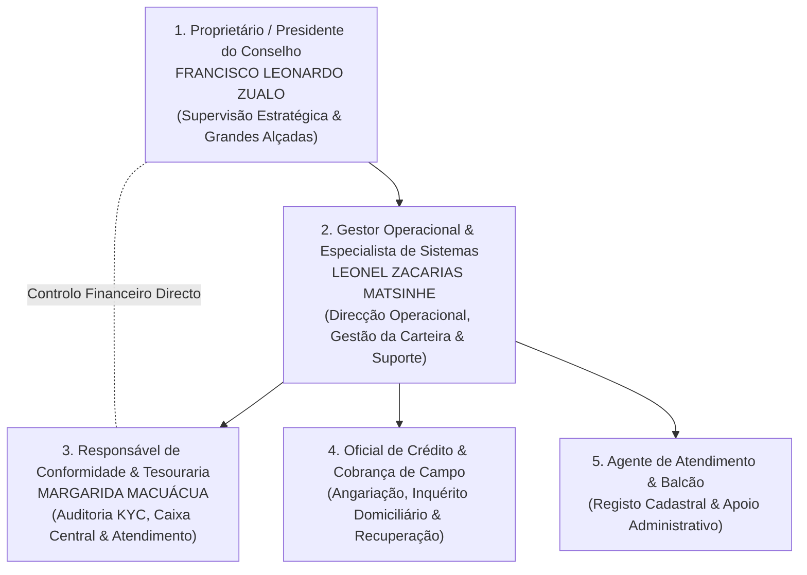

# PLANO OPERACIONAL E PROPOSTA DE GESTÃO INSTITUCIONAL
## IMPLEMENTAÇÃO, GOVERNAÇÃO E OPERAÇÕES DA CLACK MICROCRÉDITO

---

| **DOCUMENTO DE GESTÃO ESTRATÉGICA** | **DETALHES DE REFERÊNCIA** |
| :--- | :--- |
| **Instituição / Empresa:** | **Clack Microcrédito** |
| **Promotor / Proprietário:** | **Francisco Leonardo Zualo** |
| **Gestor Executivo & Especialista de Sistemas:** | **Leonel Zacarias Matsinhe** |
| **Responsável de Conformidade (KYC) e Tesouraria:** | **Margarida Macuácua** |
| **Data Prevista de Início das Operações:** | **01 de Novembro de 2026** |
| **Plataforma Tecnológica Central:** | Sistema Integrado de Gestão de Microcrédito |
| **Enquadramento Regulatório:** | Normas Prudenciais do Banco de Moçambique (BM) |
| **Versão do Documento:** | 1.0 — Proposta Executiva de Governação |

---

## 1. APRESENTAÇÃO E NOTA EXECUTIVA

Prezado Senhor **Francisco Leonardo Zualo**,

Na qualidade de proponente para a Gestão Executiva e Operacional da **Clack Microcrédito** e fornecedor da solução tecnológica integrada **Sistema Integrado de Gestão de Microcrédito**, apresento o presente plano de operações, estruturação do quadro de pessoal e governação institucional com vista ao início efectivo das actividades agendado para o dia **01 de Novembro de 2026**.

O sucesso e a rentabilidade sustentada da **Clack Microcrédito** assentam em três pilares fundamentais:
1. **Rigor e Consciência no Risco de Crédito:** Avaliação prudencial da capacidade de endividamento real dos mutuários, respeitando as normas do Banco de Moçambique (BM).
2. **Segregação Estrita de Funções e Controlo Interno:** Separação entre a angariação, análise cadastral, conferência documental, aprovação de crédito e desembolso físico/electrónico.
3. **Automação Tecnológica e Rastreabilidade Integral:** Eliminação de processos manuais vulneráveis através da plataforma do Sistema Integrado de Gestão de Microcrédito, assegurando reconciliação em tempo real com canais bancários e carteiras móveis (M-Pesa Open API).

Este documento detalha o modelo operacional completo, a repartição de competências e as rotinas diárias indispensáveis para salvaguardar o seu capital, garantir alta produtividade da equipa e proporcionar uma carteira saudável com taxas mínimas de incumprimento (PAR).

---

## 2. ORGANOGRAMA FUNCIONAL E QUADRO IDEAL DE PESSOAL

Para uma operação eficiente, enxuta e devidamente controlada na fase de arranque e expansão, recomenda-se uma equipa composta por **4 a 5 colaboradores directos**. Esta estrutura assegura o princípio bancário dos **"quatro olhos"** (nenhuma operação financeira é executada por apenas uma pessoa sem validação independente).



### 2.1. Funções, Perfis e Responsabilidades do Quadro de Pessoal

| Posição | Titular Proposto | Papel e Responsabilidades Chave | Nível no Sistema de Gestão |
| :--- | :--- | :--- | :--- |
| **Proprietário / Promotor** | **Francisco Leonardo Zualo** | Supervisão societária, definição de políticas de juros, aprovação de créditos acima da alçada do gestor, aprovação de desembolsos de grande volume e auditoria final de contas. | **Administrador (Perfil 1)** |
| **Gestor Operacional & Técnico** | **Leonel Zacarias Matsinhe** | Direcção diária da empresa, análise de solvabilidade, simulações prudenciais, formação e liderança da equipa, manutenção técnica e parametrização do software. | **Gestor de Crédito (Perfil 3)** |
| **Resp. de Conformidade & Tesouraria** | **Margarida Macuácua** | Auditoria e validação de dossiers KYC, custódia e fecho diário da folha de caixa físico, conferência de garantias reais e gestão de atendimento ao mutuário. | **Operador / Auditor (Perfil 2 / Especial)** |
| **Oficial de Crédito & Cobrança** | A Contratar (1 Colaborador) | Angariação no terreno, verificação presencial do negócio e residência, avaliação de bens de garantia (ICR) e cobrança preventiva porta a porta. | **Operador de Crédito (Perfil 2)** |
| **Assistente de Balcão (Opcional)** | A Contratar (1 Colaborador) | Recepção de mutuários, digitalização e submissão de documentos, emissão de extractos e impressão de formulários. | **Operador de Balcão (Perfil 2)** |

---

## 3. ATRIBUIÇÃO ESTRATÉGICA DA PASTA DE MARGARIDA MACUÁCUA

> [!IMPORTANT]
> **Definição da Pasta:** Recomenda-se formalmente a designação de **Margarida Macuácua** para o cargo de:
> **Directora de Conformidade (Compliance), Auditoria KYC e Controlo de Tesouraria**

### 3.1. Justificação e Vantagem Estratégica
Em microfinanças, o maior risco de perda financeira advém de:
* Concessão de crédito com documentos falsificados ou incompletos (fraude cadastral).
* Desvio de valores em numerário na folha de caixa ou cobrança fictícia.
* Desembolsos executados sem garantias físicas comprovadas.

Sendo esposa do proprietário e pessoa da sua mais estrita e incondicional confiança, a sua colocação na linha de **Auditoria Documental e Tesouraria** confere à família o controlo absoluto das chaves do cofre e da legitimidade de cada metical desembolsado, operando com total independência em relação à equipa de campo e vendas.

### 3.2. Responsabilidades Concretas no Dia a Dia:
1. **Validação Obrigatória do Dossier KYC:** Nenhum contrato pendente é libertado para desembolso sem a confirmação de Margarida no sistema (conferência de BI válido, NUIT oficial, Declaração do Bairro e Comprovativo de Rendimentos).
2. **Custódia das Garantias Físicas (ICR):** Registo, guarda física e emissão de autos de apreensão/penhor de títulos de propriedade, livretes de viaturas e electrodomésticos empenhados.
3. **Conferência da Folha de Caixa Diária:** Execução do procedimento de conferência física das notas em numerário às 16h30, cruzando com os recibos gerados no sistema e os extractos do M-Pesa Empresarial.
4. **Atendimento de Excelência e Relações com Mutuários:** Acolhimento inicial no balcão e explicação pedagógica do plano de amortização e das datas de vencimento das prestações.

---

## 4. O PAPEL DO DONO (FRANCISCO LEONARDO ZUALO)

Como investidor e proprietário da **Clack Microcrédito**, o senhor Francisco Leonardo Zualo não deve ficar sobrecarregado com a rotina operacional mecânica, mas deve manter o **controlo financeiro estratégico, as alçadas soberanas e a auditoria de alto nível**.

### 4.1. Competências Decisórias Exclusivas do Proprietário:
* **Grandes Alçadas de Concessão:** Decisão exclusiva de aprovação de propostas de crédito superiores a **50.000,00 MZN** ou prazos acima de 6 meses.
* **Autorização de Desembolsos Bancários:** Autorização final de pagamentos por transferência bancária (BIM, BCI, Standard Bank, Moza) e gestão dos saldos mestres da conta M-Pesa B2C.
* **Perdão de Juros de Mora ou Reestruturações Especiais:** Decisão sobre condições extraordinárias de liquidação para mutuários em contencioso avançado.
* **Retirada de Lucros e Gestão de Liquidez:** Planeamento da alocação de capital próprio e distribuição de dividendos mensais com base no balancete gerado pelo sistema.
* **Reunião de Prestação de Contas:** Sessão semanal às segundas-feiras com Leonel Matsinhe e Margarida Macuácua para análise do Relatório de Carteira e Indicador de Risco (PAR30, PAR60 e PAR90).

---

## 5. FLUXOGRAMA OPERACIONAL GRÁFICO INTEGRAL (SISTEMA INTEGRADO DE GESTÃO DE MICROCRÉDITO)

O ciclo de vida de todas as operações de crédito obedece a um processo contínuo, padronizado e auditável, garantindo a conformidade com as normas do Banco de Moçambique e a protecção do capital da instituição.

### 5.1. Diagrama de Fluxo Ponta a Ponta (End-to-End)

```mermaid
flowchart TD
    subgraph ETAPA1 ["ETAPA 1: ANGARIAÇÃO & REGISTO CADASTRAL"]
        A1["Mutuário procura a instituição\n(Balcão ou Agente de Terreno)"] --> A2["Preenchimento da Ficha Cadastral\n(Dados Pessoais, Emprego/Negócio, Contactos)"]
        A2 --> A3["Registo do Mutuário no Sistema de Gestão\n(Geração do ID Único do Cliente)"]
    end

    subgraph ETAPA2 ["ETAPA 2: SUBMISSÃO & AUDITORIA DE DOSSIER KYC"]
        A3 --> B1["Carregamento de Documentos Obrigatórios:\n• BI Válido / DIRE\n• NUIT Oficial\n• Declaração de Residência do Bairro\n• Comprovativo de Rendimentos (Recibo/Extracto)"]
        B1 --> B2{"Auditoria Documental\n(Margarida Macuácua)\nDossier 100% Conforme?"}
        B2 -- Não --> B3["DESEMBOLSO BLOQUEADO NO SISTEMA\nNotificação de Documento em Falta"]
        B3 --> B1
    end

    subgraph ETAPA3 ["ETAPA 3: SIMULAÇÃO PRUDENCIAL & GARANTIAS (ICR)"]
        B2 -- Sim: Dossier Validado --> C1["Simulação na Calculadora de Crédito\n(Montante, Prazo e Taxa)"]
        C1 --> C2{"Teste do Teto Prudencial BM:\nPrestação <= 1/3 do Rendimento Líquido?"}
        C2 -- Ultrapassa Teto --> C3["Alerta de Sobreendividamento (Vermelho)\nReduzir Montante ou Alargar Prazo"]
        C3 --> C1
        C2 -- Conforme Teto --> C4["Vistoria e Registo de Garantias Reais\n(ICR: Bens Domésticos, Viaturas, Equipamentos)"]
        C4 --> C5["Cálculo do Índice de Cobertura de Risco\n(ICR >= 120% a 150% do capital financiado)"]
    end

    subgraph ETAPA4 ["ETAPA 4: MATRIZ DE APROVAÇÃO & ALÇADAS"]
        C5 --> D1{"Valor do Financiamento"}
        D1 -- "Até 50 000,00 MZN" --> D2["Aprovação Operacional\n(Leonel Zacarias Matsinhe - Gestor)"]
        D1 -- "Superior a 50 000,00 MZN" --> D3["Aprovação Estratégica / Soberana\n(Francisco Leonardo Zualo - Proprietário)"]
        D2 --> D4["Geração do Contrato Legal no Sistema\n(Hash Digital de Segurança, Código QR e Termo BM)"]
        D3 --> D4
        D4 --> D5["Assinatura Presencial e Reconhecimento do Contrato\n(Mutuário, Avalista/Cônjuge e Gestão)"]
    end

    subgraph ETAPA5 ["ETAPA 5: EXECUÇÃO DO DESEMBOLSO SEGURO"]
        D5 --> E1{"Canal de Pagamento Seleccionado"}
        E1 -- "M-Pesa B2C (Recomendado)" --> E2["Desembolso Electrónico Instantâneo via API\n(Saldo entra na Carteira Móvel do Mutuário)"]
        E1 -- "Transferência Bancária" --> E3["Ordem Bancária Assinada por Francisco Zualo\n(BIM, BCI, Standard Bank, Moza)"]
        E2 --> E4["Activação Imediata do Contrato & Plano de Amortização"]
        E3 --> E4
    end

    subgraph ETAPA6 ["ETAPA 6: ACOMPANHAMENTO, PREVENÇÃO & COBRANÇA"]
        E4 --> F1["Monitorização Activa da Carteira"]
        F1 --> F2["SMS Automática Informativa: 3 Dias Antes do Vencimento"]
        F2 --> F3["SMS no Dia do Vencimento da Prestação"]
        F3 --> F4{"O Mutuário Pagou\nna Data Prevista?"}
    end

    subgraph ETAPA7 ["ETAPA 7: REEMBOLSO, AMORTIZAÇÃO & RECIBOS"]
        F4 -- Sim --> G1{"Canal de Liquidação"}
        G1 -- "M-Pesa C2B" --> G2["Reconciliação Automática no Sistema\n(Baixa Imediata da Prestação no Extracto)"]
        G1 -- "Numerário no Balcão" --> G3["Recepção por Margarida Macuácua\n(Emissão Obrigatória de Recibo Digital do Sistema)"]
        G2 --> G4["Actualização do Saldo Devedor do Contrato"]
        G3 --> G4
        G4 --> G5{"Todas as Prestações\nForam Amortizadas?"}
        G5 -- Não --> F1
    end

    subgraph ETAPA8 ["ETAPA 8: GESTÃO DE MORA & RECUPERAÇÃO DE CRÉDITO"]
        F4 -- Não --> H1["Entrada em Incumprimento (PAR)\nCálculo Automático de Juros de Mora no Sistema"]
        H1 --> H2["D+1 a D+3: Alerta SMS e Chamada de Cobrança Preventiva"]
        H2 --> H3["D+4 a D+15: Notificação Formal e Visita de Campo ao Domicílio"]
        H3 --> H4{"Acordo de Regularização\nAlcançado?"}
        H4 -- Sim --> G1
        H4 -- Não: D+30+ --> H5["Comité de Contencioso (Francisco, Leonel, Margarida)\nExecução Legal da Garantia ICR e Notificação Policial/Judicial"]
    end

    subgraph ETAPA9 ["ETAPA 9: QUITAÇÃO & FIDELIZAÇÃO (CICLO COMPLETO)"]
        G5 -- Sim --> I1["Liquidação Integral do Contrato no Sistema"]
        I1 --> I2["Emissão da Declaração Formal de Quitação de Dívida"]
        I2 --> I3["Devolução Formal dos Bens / Títulos de Garantia (ICR)"]
        I3 --> I4["Atribuição de Bom Score Interno de Crédito\n(Elegível a Renovação Imediata com Maior Limite)"]
    end
```



---

### 5.2. Detalhamento Operacional de Cada Etapa do Fluxograma

| Fase do Fluxo | Acção Principal | Responsável Operacional | Mecanismo de Controlo no Sistema |
| :--- | :--- | :--- | :--- |
| **1. Registo Cadastral** | Inquérito e inserção dos dados do cliente. | Oficial de Balcão / Agente | Verificação de duplicidade de NUIT e BI para impedir cadastros repetidos. |
| **2. Dossier KYC** | Upload dos 4 documentos obrigatórios. | **Margarida Macuácua** | **Bloqueio visual e sistémico:** impossibilita avançar para desembolso se faltar algum comprovativo. |
| **3. Análise Prudencial** | Simulação do plano e cálculo do teto de 1/3. | **Leonel Matsinhe** | Bloqueador automático em caso de esforço financeiro excessivo; exigência de garantia ICR >= 120%. |
| **4. Alçadas de Decisão** | Aprovação do crédito conforme valor. | **Leonel** (até 50k) / **Francisco** (+50k) | Segregação estrita de perfis; registo de utilizador com carimbo de data/hora na base de dados. |
| **5. Desembolso** | Disponibilização do dinheiro. | **Francisco Zualo** (Bancos) / **Leonel** (M-Pesa) | Canal seguro M-Pesa B2C Open API com geração de ID de transacção irrevogável. |
| **6. Acompanhamento** | Prevenção de incumprimento. | Sistema de Gestão (Automação) | Disparos programados de mensagens SMS preventivas aos 3 dias antes e no dia de vencimento. |
| **7. Reembolso** | Cobrança da prestação mensal. | Mutuário / **Margarida** | Baixa imediata da prestação, emissão do extracto oficial e recibo digital em tempo real. |
| **8. Recuperação (Mora)** | Cobrança coerciva de valores em atraso. | Oficial de Campo & **Leonel** | Classificação do risco nos indicadores regulamentares BM (PAR15, PAR30, PAR60 e PAR90). |
| **9. Quitação** | Encerramento e libertação de garantias. | **Margarida** & **Leonel** | Emissão de termo de quitação com código QR e elevação da pontuação de risco para renovação. |

---

## 6. MATRIZ DE ALÇADAS DE CRÉDITO E SEPARAÇÃO DE PODERES

Para assegurar agilidade nas pequenas operações sem comprometer a segurança nas operações de maior vulto, estabelece-se a seguinte tabela de competências:

| Escalão de Valor (MZN) | Limite de Prazo | Análise Cadastral e Risco | Verificação KYC & Garantias | Nível de Aprovação Final | Modo de Desembolso |
| :---: | :---: | :---: | :---: | :---: | :---: |
| **1.000,00 a 20.000,00** | Até 3 meses | Oficial de Crédito | Margarida Macuácua | **Leonel Matsinhe** (Gestor) | M-Pesa Open API Directo |
| **20.001,00 a 50.000,00** | Até 6 meses | Leonel Matsinhe | Margarida Macuácua | **Leonel Matsinhe** (Gestor) | M-Pesa ou Transferência |
| **50.001,00 a 500.000,00+** | Até 24 meses | Leonel Matsinhe | Margarida Macuácua | **Francisco Zualo** (Proprietário) | Transferência Bancária / M-Pesa |

> [!NOTE]
> **Regra de Ouro Prudencial (Banco de Moçambique):**
> Em nenhum caso a prestação mensal calculada poderá ultrapassar **33,33% (1/3)** do rendimento líquido comprovado do mutuário. O sistema bloqueia automaticamente simulações que violem este tecto, protegendo a instituição contra sobreendividamento do cliente.

---

## 7. RITUAIS E ROTINAS DIÁRIAS, SEMANAIS E MENSAIS

### 7.1. Rotina Diária (Segunda a Sexta-feira)

| Horário | Actividade Operacional | Responsável |
| :--- | :--- | :--- |
| **07h45 – 08h15** | **Alinhamento Matinal (Briefing):** Abertura do sistema, verificação dos créditos a vencer no dia, emissão do relatório de cobranças previstas e metas do dia. | Leonel Matsinhe / Equipa |
| **08h15 – 08h30** | **Abertura de Caixa:** Conferência do fundo de maneio inicial em numerário e validação do saldo inicial no sistema. | Margarida Macuácua |
| **08h30 – 12h30** | **Atendimento ao Público & Concessão:** Recepção de novos pedidos, upload de dossiers KYC, avaliações patrimoniais e recepção de amortizações ao balcão. | Margarida / Agentes |
| **12h30 – 13h30** | Intervalo rotativo de almoço (garantindo balcão permanentemente assistido). | Equipa |
| **13h30 – 16h00** | **Trabalho de Campo & Cobranças Preventivas:** Diligências externas de confirmação de domicílio, cobrança a mutuários em atraso de 1 a 15 dias. | Oficial de Cobrança |
| **16h00 – 16h30** | **Apreciação de Créditos do Dia:** Análise e submissão das propostas de financiamento recolhidas para aprovação do Gestor/Dono. | Leonel Matsinhe |
| **16h30 – 17h15** | **Fecho Diário de Caixa & Reconciliação:** Fecho da folha de caixa no sistema, conferência nota a nota do numerário, conciliação do extracto de transacções M-Pesa e depósito bancário das receitas em numerário. | Margarida Macuácua / Leonel |

### 7.2. Rotina Semanal (Segundas-feiras, 17h30)
* **Comité de Gestão e Carteira:** Reunião formal entre **Francisco Zualo**, **Leonel Matsinhe** e **Margarida Macuácua**.
* Apresentação do indicador de crédito em risco (**PAR30, PAR60, PAR90**).
* Análise dos mutuários com processos a avançar para a via judicial/recuperação coerciva com apreensão de bens.
* Balanço de receitas com juros, comissões cobradas e margem operacional líquida da semana.

### 7.3. Rotina Mensal (Último dia útil do mês)
* Fecho contabilístico e emissão do mapa de provisões para créditos de liquidação duvidosa.
* Emissão dos mapas de reporte regulamentar no padrão exigido pelo **Banco de Moçambique**.
* Elaboração do balanço financeiro e cálculo da rentabilidade do capital empregue para apreciação do proprietário.

---

## 8. PLANO DE FORMAÇÃO DA EQUIPA (01 A 15 DE NOVEMBRO DE 2026)

Para que toda a equipa domine o Sistema Integrado de Gestão de Microcrédito e actue com segurança logo no primeiro dia, estabelece-se o seguinte cronograma prático de formação ministrado por **Leonel Zacarias Matsinhe**:

```
MÓDULO 1 (01 a 03 Nov): Fundamentos do Microcrédito, Normas BM e Atendimento
MÓDULO 2 (04 a 06 Nov): Domínio do Sistema Integrado de Gestão de Microcrédito: Cadastro e Gestão do Dossier KYC
MÓDULO 3 (07 a 09 Nov): Calculadora Prudencial, Garantias ICR e Formalização Contratual
MÓDULO 4 (10 a 12 Nov): Tesouraria, Caixa Físico, Pagamentos M-Pesa e Recibos Digitais
MÓDULO 5 (13 a 15 Nov): Gestão de Cobrança em Atraso, Risco PAR e Simulações Reais de Auditoria
```

### Detalhe do Programa de Capacitação:
1. **Módulo Balcão e Cadastro:** Como recolher e digitalizar com nitidez o BI, NUIT, declaração residencial e comprovativo de rendimentos para anular o risco de rejeição no sistema.
2. **Módulo de Análise e ICR:** Avaliação correcta de bens de garantia (viaturas, equipamentos, bens domésticos), preenchimento do auto de penhor e registo fotográfico.
3. **Módulo de Caixa e Tesouraria (Especial para Margarida Macuácua):** Operações de recebimento de prestação com geração imediata de recibo, anulação justificada com perfil de auditoria, e protocolo diário de fecho de caixa cego.
4. **Módulo de Cobrança e Notificações:** Utilização dos alertas automatizados por SMS aos mutuários (3 dias antes do vencimento, no dia do vencimento e em caso de mora).

---

## 9. ÂMBITO DOS SERVIÇOS DE ASSISTÊNCIA TÉCNICA E MANUTENÇÃO

Como gestor e fornecedor técnico da plataforma, assumo o compromisso formal de assistência técnica integral, abrangendo:

| Nível de Serviço | Descrição e Garantias de Desempenho |
| :--- | :--- |
| **Disponibilidade da Plataforma (SLA)** | Garantia de funcionamento ininterrupto da plataforma de **99.5%** durante o horário comercial. |
| **Cópias de Segurança (Backups)** | Realização de cópias de segurança diárias automáticas em servidor seguro em nuvem, garantindo protecção total contra perda física de computadores ou avarias. |
| **Actualizações Regulatórias** | Ajustes contínuos no software em resposta a quaisquer novas directivas, taxas de referência ou avisos emitidos pelo **Banco de Moçambique**. |
| **Segurança e Protecção de Dados** | Criptografia das senhas de acesso, isolamento de empresas na base de dados e registo de auditoria (*logs*) de todas as acções dos colaboradores. |
| **Suporte aos Canais de Pagamento** | Manutenção da conectividade com o gateway do M-Pesa Open API para assegurar processamento instantâneo de cobranças e desembolsos. |

---

## 10. TERMO DE ACORDO E COMPROMISSO DE ARRANQUE

O presente plano foi elaborado com o propósito de dotar a **Clack Microcrédito**, propriedade do senhor **Francisco Leonardo Zualo**, dos mais elevados padrões de excelência bancária, garantindo solidez, respeito escrupuloso pela regulamentação do Banco de Moçambique e rentabilidade sustentável.

Aprovado e aceite por todas as partes em Maputo, aos \_\_\_\_\_\_ de \_\_\_\_\_\_\_\_\_\_\_\_\_\_ de 2026.

<br><br>

__________________________________________________  
**FRANCISCO LEONARDO ZUALO**  
*Proprietário / Administrador Geral — Clack Microcrédito*

<br><br>

__________________________________________________  
**LEONEL ZACARIAS MATSINHE**  
*Gestor Operacional & Especialista de Sistemas — Clack Microcrédito*

<br><br>

__________________________________________________  
**MARGARIDA MACUÁCUA**  
*Directora de Conformidade (KYC) e Tesouraria — Clack Microcrédito*
